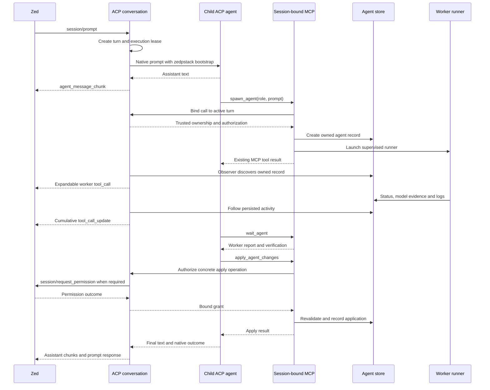

# Candidato de arquitectura de Codex

Modelo: gpt-6.1-sol
Runtime: codex
Fecha: 2026-10-17

Candidato de diseño del corte de arquitectura; la decisión final está en docs/ACP_DESIGN.md

Recommend an ACP supervisor that hosts one persistent child ACP agent per Zed thread. Use `claude-agent-acp`, `codex-acp`, and Cursor's native `agent acp`. Keep pstack's orchestration in the LLM and zedpstack's worker lifecycle in the existing core. Do not build three headless conversation engines.

## Usage, caller's view

The user opens a zedpstack thread:

```text
/claude
```

The footer shows that runtime's model, effort, and permission controls. Selecting a model configures the orchestrator only. The worker sheet still controls delegated roles.

```text
Investigate why cancellation leaves a process running.
```

Assistant text streams into the thread. Calls to zedpstack's MCP tools dispatch workers, which appear as expandable cards. The orchestrator reads their reports, reviews writer commits, and applies accepted changes through the existing tools.

Three representative adapter call sites:

```js
// /claude, /codex and /cursor use the same operation.
const configuration = await conversation.selectRuntime('claude');
publishConfiguration(configuration);

// Footer changes validate and apply through the selected child.
const configuration = await conversation.configure({
  controlId: 'model',
  value: 'claude-opus-5-5',
});
publishConfiguration(configuration);

// Worker discovery, permissions and cancellation belong to the conversation.
const outcome = await conversation.prompt({
  text: 'Investigate why cancellation leaves a process running.',
});
```

`prompt()` does not require the caller to start a watcher, inject a skill, maintain a CLI resume ID, or collect spawned agent IDs.

Assumptions:

- External ACP executables can be installed separately and pinned. The package retains zero runtime npm dependencies.
- Existing CLI authentication remains authoritative.
- Runtime switches happen between turns. Switching runtimes transfers the visible conversation into a new native session; native hidden reasoning is not transferable.
- A runtime must pass the required compatibility checks before zedpstack presents it as usable.

## Problem and grounding

The existing lifecycle already owns the right worker responsibilities. It resolves models, creates writer worktrees, launches detached runners, collects results, and applies commits. Moving those files into a new directory would add churn without changing ownership. See [lifecycle.mjs](/Users/nndsk/Projects/zedpstack/src/agents/lifecycle.mjs:63) and [ARCHITECTURE.md](/Users/nndsk/Projects/zedpstack/docs/ARCHITECTURE.md:11).

The ACP spike currently handles a different interaction. Unknown text becomes help, and its turn tracks only the worker IDs it spawned directly. It ignores forwarded MCP servers. See [server.mjs](/Users/nndsk/Projects/zedpstack/src/acp/server.mjs:105) and [ACP_SPIKE.md](/Users/nndsk/Projects/zedpstack/docs/ACP_SPIKE.md:45).

Four inherited decisions require correction:

| Finding | Evidence | Design consequence |
|---|---|---|
| Atomic publication does not make record updates transactional. Two processes can read the same record and overwrite each other's patches. | [store.mjs:44](/Users/nndsk/Projects/zedpstack/src/agents/store.mjs:44), [store.mjs:58](/Users/nndsk/Projects/zedpstack/src/agents/store.mjs:58) | Serialize the genuinely shared lifecycle transitions per agent. |
| Reading status can write a failure through reconciliation. | [lifecycle.mjs:238](/Users/nndsk/Projects/zedpstack/src/agents/lifecycle.mjs:238) | Reconciliation must recheck the current record inside that transaction. |
| The orchestrator guard uses one mutable session marker per repository. | [guard.mjs:7](/Users/nndsk/Projects/zedpstack/src/guard.mjs:7), [guard.mjs:15](/Users/nndsk/Projects/zedpstack/src/guard.mjs:15) | ACP authorization must be scoped to a thread, rather than inherited from that marker. |
| Effective models are recorded but never compared with an expected identity. | [lifecycle.mjs:201](/Users/nndsk/Projects/zedpstack/src/agents/lifecycle.mjs:201), [PROBLEMAS_ACTUALES.md:7](/Users/nndsk/Projects/zedpstack/PROBLEMAS_ACTUALES.md:7) | Model verification becomes an outcome contract, not a board annotation. |

The existing manifest mutex is process-local, so it cannot solve cross-process agent updates. See [manifestLock.mjs](/Users/nndsk/Projects/zedpstack/src/manifestLock.mjs:1).

## Shape

### Host native ACP agents

Each outer conversation owns one supervisor and one active child ACP connection:

```text
Zed thread
  → zedpstack ACP conversation
      → supervised child ACP agent
          → session-bound zedpstack MCP server
              → existing worker lifecycle
```

The persistent child owns native conversation continuity. zedpstack owns the outer thread identity, configuration, permissions for zedpstack operations, worker visibility, and process cleanup.

The upstream implementations justify this choice:

- Claude's adapter supports client MCP servers, tool permission requests, edit review, and terminals. [Claude ACP implementation](https://github.com/agentclientprotocol/claude-agent-acp).
- The maintained Codex adapter starts Codex App Server and translates its configuration and events into ACP. The old `zed-industries` repository is archived and points to the maintained repository. [Codex ACP implementation](https://github.com/agentclientprotocol/codex-acp), [archived repository](https://github.com/zed-industries/codex-acp).
- Cursor documents `agent acp`, native session loading, modes, permission requests, and blocking extension requests. Its documentation does not establish that forwarded `mcpServers` works, so that remains a mandatory compatibility check. [Cursor ACP documentation](https://cursor.com/docs/cli/acp).

The proxy preserves assistant messages, emitted reasoning, plans, tool content, diffs, and terminals that both endpoints support. It does not promise features the child never emits or Zed never renders.

Per **boundary-discipline**, ACP parsing and runtime extensions stay inside the ACP implementation. Core APIs receive domain values.

### Module map

| Module | Responsibility |
|---|---|
| Existing `src/agents/lifecycle.mjs` | Remains the worker facade. Adds trusted ownership context, model verification, supervised stopping, and coordinated application. |
| Existing `src/agents/store.mjs` | Owns record creation, transactions, legal transitions, revision numbers, and atomic publication. Raw replacement writes cease to be a caller API. |
| New `src/agents/observe.mjs` | Discovers agents and follows persisted status and logs. Receives an ownership filter and emits domain events. |
| Existing `src/acp/follow.mjs` | Move its protocol-independent following logic into `agents/observe.mjs`; migrate callers and delete the old implementation. |
| Existing `src/acp/server.mjs` | Outer ACP methods, response routing, client capability negotiation, and encoding domain presentation into ACP. |
| New `src/acp/conversation.mjs` | Owns one thread's state, configuration, transcript, active turn, worker subscription, and permission decisions. |
| New `src/acp/child.mjs` | Bidirectional child ACP connection, ID translation, private runtime compatibility profiles, and native session continuity. |
| New `src/acp/supervisor.mjs` | Process groups, owner connection loss, shutdown deadlines, and durable recovery metadata. Runs as a small supervising process. |
| New `src/acp/control.mjs` | Private local connection between the conversation and its MCP subprocess. Binds calls to the current turn and carries permission decisions. |
| Existing `src/mcp/server.mjs` and `tools.mjs` | Keep public MCP names, schemas, prompts, and result format. Accept an optional trusted execution context internally. |
| Existing model modules | Continue to own worker role routing and worker sheets. The orchestrator's live model catalog remains separate. |

Do not introduce `src/core/*` forwarding wrappers. `agents/lifecycle.mjs` already concentrates substantial behavior behind a small interface.

The core does not import ACP or MCP. A dependency-boundary check should enforce that adapters use the lifecycle and observation contracts rather than raw store mutation.

### Core data structures and signatures

These are JS/JSDoc sketches. Boundary constructors validate them; JSDoc alone does not enforce runtime invariants.

```js
/** @typedef {'claude'|'codex'|'cursor'} Runtime */

/**
 * Created by trusted session plumbing, never from model-supplied tool arguments.
 * @typedef {{
 *   sessionId: string,
 *   turnId: string,
 *   generation: number
 * }} AgentOwner
 */

/**
 * Every option comes from the selected runtime's capability snapshot.
 * @typedef {{
 *   id: string,
 *   kind: 'runtime'|'model'|'effort'|'permission'|'workflow'|'other',
 *   label: string,
 *   selected: string,
 *   choices: Array<{value: string, label: string, description?: string}>
 * }} Control
 */

/**
 * @typedef {{
 *   runtime: Runtime,
 *   controls: Control[],
 *   revision: number
 * }} Configuration
 */

/**
 * @typedef {
 *   {kind:'pending', expected:string} |
 *   {kind:'verified', expected:string, effective:string, evidence:string} |
 *   {kind:'mismatch', expected:string, effective:string, evidence:string} |
 *   {kind:'unavailable', expected:string, reason:string}
 * } ModelVerification
 */

/**
 * @typedef {
 *   {kind:'unselected'} |
 *   {kind:'idle', generation:number, configuration:Configuration} |
 *   {kind:'running', generation:number, turnId:string,
 *    configuration:Configuration, verification:ModelVerification} |
 *   {kind:'closing'} |
 *   {kind:'closed'}
 * } ConversationState
 */

/**
 * @typedef {
 *   {kind:'ended', verification:ModelVerification} |
 *   {kind:'cancelled'} |
 *   {kind:'refused', reason:string} |
 *   {kind:'failed', reason:string, retry:'safe'|'inspect-first'}
 * } TurnOutcome
 */

/**
 * Owns native continuity, skill bootstrap, observation and cleanup.
 * No ACP wire types escape this interface.
 */
export class Conversation {
  /** @returns {Promise<Configuration>} */
  async selectRuntime(runtime) {
    throw new Error('not implemented');
  }

  /** @returns {Promise<Configuration>} */
  async configure({ controlId, value }) {
    throw new Error('not implemented');
  }

  /** @returns {Promise<TurnOutcome>} */
  async prompt({ text, context = [] }) {
    // TODO: establish turn ownership before granting MCP execution.
    // TODO: bootstrap SKILL.md once per native session.
    // TODO: supervise native prompt and collect its terminal outcome.
    throw new Error('not implemented');
  }

  /** Idempotent; resolves after this turn's supervised work stops. */
  async cancel() {
    throw new Error('not implemented');
  }

  /** Idempotent; preserves reports and writer worktrees. */
  async close() {
    throw new Error('not implemented');
  }
}

/** Atomic, cross-process mutation of one agent's lifecycle state. */
export async function transactAgent({ repo, id, transition }) {
  // TODO: acquire per-agent lock, reread, apply legal transition,
  // increment revision, publish atomically, release.
  throw new Error('not implemented');
}

/** Discovers records independently of which frontend spawned them. */
export async function observeAgents({ repo, owner, signal, onEvent }) {
  // TODO: initial scan, fs.watch hints, periodic reconciliation,
  // deduplicate by agent ID and follow persisted logs.
  throw new Error('not implemented');
}
```

The five conversation operations correspond to user actions. They hide protocol initialization, session IDs, skill injection, permission routing, model checks, and worker discovery. That gives the interface depth without adding a long call chain.

### Configuration and model identity

Use child session configuration as the primary source for orchestrator controls. Do not use the worker sheet as an orchestrator model catalog.

The verified ACP v1 shapes are:

```js
// session/new result
{ sessionId, configOptions: [
  {
    id: 'model',
    name: 'Model',
    category: 'model',
    type: 'select',
    currentValue: 'concrete-model-id',
    options: [{ value: 'concrete-model-id', name: 'Model name' }],
  },
] }

// Client request
{
  method: 'session/set_config_option',
  params: { sessionId, configId: 'model', value: 'concrete-model-id' },
}

// Agent update
{
  sessionUpdate: 'config_option_update',
  configOptions: completeConfiguration,
}
```

Both the setter response and agent update contain the complete configuration. Use `thought_level` for effort and `mode` for permission or workflow selectors as appropriate. Custom categories begin with `_`. Select controls work without boolean capability negotiation. [ACP configuration specification](https://agentclientprotocol.com/protocol/v1/session-config-options).

Maintain older `modes` only as a derived compatibility representation. Its fields are `currentModeId` and `availableModes`; setters use `modeId`, and updates use `current_mode_update`. Do not keep independently mutable mode state. [ACP modes specification](https://agentclientprotocol.com/protocol/v1/session-modes).

Implementation rules:

- Advertise `/claude`, `/codex`, `/cursor`, and `/board` after the outer `session/new` response.
- `/claude` invokes the same configuration operation as a runtime selector. The command does not reach the model as ordinary prose.
- Normalize child controls into domain `Control` values. Keep child IDs and translation details private.
- Obtain models and model-dependent effort choices from the child. Use existing CLI discovery only when a pinned profile explicitly needs it.
- Cursor's `agent --list-models` and Codex's local cache are already implemented in [setupWizard.mjs](/Users/nndsk/Projects/zedpstack/src/setupWizard.mjs:123). They are discovery inputs, not proof of current account access.
- Keep potentially paid Claude probes out of automatic thread creation.
- Persist last successful selections per runtime under `~/.zedpstack/acp/preferences/<runtime>.json`. Revalidate them against live choices.
- Apply configuration atomically after child acknowledgement. A request received during generation waits for the turn boundary; cancellation remains independently routable.
- A permission restriction takes effect immediately at the zedpstack action gate.

The expected model is an explicit identity. If an alias is offered, label its resolved identity and pin that identity for execution. Never infer that `opus` means the newest Opus.

Record the requested identity, expected concrete identity, effective identity, executable path, version, and evidence source. Compare identities before accepting a model-attributed verdict. Explicit, documented equivalences may account for provider snapshot suffixes; family-name or prefix matching is insufficient.

For Claude, the upstream adapter can emit filtered raw SDK messages through `_claude/sdkMessage`. Its assistant message metadata contains the effective model. Consume that privately, alongside the rendered ACP stream. [Claude adapter source](https://raw.githubusercontent.com/agentclientprotocol/claude-agent-acp/main/src/acp-agent.ts).

ACP v1 configuration is not an effective-model attestation. Each Codex and Cursor profile must demonstrate a reliable evidence source. Missing evidence yields `unavailable`, not `verified`. A mismatch stops further risky actions and leaves the relevant review pending. Keep partial output visible with its verification status.

Apply this same verifier to existing workers, which already capture effective-model metadata.

### Worker discovery and ownership

The agent store remains authoritative.

The conversation injects a session-bound zedpstack MCP descriptor into the child. It forwards other enabled context servers only where the child supports their transports. Duplicate zedpstack descriptors are collapsed to the owned descriptor.

The private control connection supplies the active `AgentOwner` for each MCP call. It does not accept ownership from the LLM's arguments. This matters because a persistent MCP process cannot obtain a changing turn ID from its startup environment.

The observer:

1. Scans existing agent records.
2. Discovers new records using filesystem notifications plus periodic rescans.
3. Attaches once per matching agent ID.
4. Reads status and logs through the core observation contract.
5. Emits cards even when a separate MCP subprocess launched the worker.

Per **separate-before-serializing-shared-state**, each conversation owns its subscription and card state. It never writes progress into `agent.json`.

Owned workers appear in that thread. `/board` can display repository-wide agents, including legacy MCP workers, without acquiring cancellation authority over them.

Retain expandable `kind: "other"` worker cards, cumulative replacement content, and the existing throttle. Bound the buffers themselves, rather than keeping unlimited arrays and displaying only their last 200 lines. See [updates.mjs](/Users/nndsk/Projects/zedpstack/src/acp/updates.mjs:78).

### Permissions and proxy correctness

The current ACP transport only recognizes requests and notifications. It must also resolve responses to agent-initiated requests. Otherwise permission prompts cannot complete. See [server.mjs](/Users/nndsk/Projects/zedpstack/src/acp/server.mjs:181).

Maintain separate pending-request maps for Zed and every child. Remap session, tool-call, terminal, and request IDs using the conversation generation. Preserve negotiated metadata. Never forward raw child IDs into the outer namespace.

Native tool permissions pass through to Zed. zedpstack operations also have an authoritative action gate because a child may auto-approve MCP calls.

That gate uses session policy and existing authorization. Risky operations include applying changes, writing in place, removing worktrees or branches, and changing persistent setup. Bind a grant to its operation, commit, repository state, and turn. Recheck after any wait.

Permit the native runtime to invoke the zedpstack tools while retaining semantic authorization in this gate, avoiding duplicate approval dialogs for the same operation.

Cancellation resolves outstanding permission requests as:

```js
{ outcome: { outcome: 'cancelled' } }
```

It then settles the original prompt as cancelled. These are distinct messages in ACP v1. [ACP v1 schema](https://github.com/agentclientprotocol/agent-client-protocol/blob/main/schema/v1/schema.json).

Do not enable unsupported native subagent capabilities. Direct native edits and native delegation remain disabled by the pinned runtime profile where possible, with the zedpstack skill providing the behavioral rule. A profile must demonstrate enforcement; prompt text alone is not a sandbox.

### Concurrency and cleanup

**Agent records.** Keep logs runner-owned and presentation state session-owned. Use a per-agent cross-process lock for the remaining shared lifecycle record. The lock protects only a short transaction, never an approval wait, CLI execution, or process shutdown.

Use atomic directory acquisition with an owner token and process identity. Reclaim a lock only after establishing that its owner is dead. A timeout produces a specific failure rather than breaking a possibly live lock. Publish each revision through a uniquely named temporary file and rename.

Make transitions authoritative in one reducer:

- Terminal states cannot revert to running.
- Stop intent survives a racing completion.
- `stopped` means supervised processes have exited.
- Reconciliation rereads before declaring a runner dead.
- Late metadata cannot replace cancellation or final outcome.

Changing mutations to async transactions is justified. Update their callers together rather than providing a second unlocked path.

**Applying changes.** Per-agent locks do not protect two threads mutating the same checkout index. Add a cross-process lock keyed to the canonical target checkout. Review and permission happen outside it; acquire it, revalidate the approved repository state, then apply.

Give applications operation IDs and durable receipts. A completed retry returns its existing receipt. A crash between Git mutation and receipt produces `inspect-first`; it must not blindly cherry-pick again. Do not claim exactly-once Git effects.

**Processes.** Give each conversation a supervisor with an owner connection. Loss of that connection triggers cleanup even if the ACP process was killed without running its exit handlers. The supervisor owns launched process groups and validates process identity before signalling them.

Cancellation proceeds in this order:

1. Revoke the turn's ability to start more operations.
2. Forward child cancellation and resolve permission waits.
3. Stop workers owned by that turn, including registered descendants.
4. Escalate remaining supervised groups from SIGTERM to SIGKILL.
5. Flush card outcomes and settle the prompt once.

Keep reports, branches, and worktrees for inspection. Cleanup that deletes them is separate.

Workers from ordinary MCP hosts retain their existing survival behavior. ACP-owned workers carry an explicit owner-loss policy.

**Multiple threads.** Every thread has its own child, configuration, active turn, pending permissions, transcript, and observer. Never mutate `process.cwd()` or global environment values when selecting a runtime.

Persist outer session metadata and transcript under `.zedpstack/sessions/<id>/`. A single owner holds the session lease. Recovery loads the native session when supported and replays the outer transcript once. It never automatically repeats an interrupted mutating turn.

A runtime switch starts a new generation and seeds it with the visible conversation and report references. It does not pretend that native session IDs or hidden reasoning are portable.

## One orchestrated turn



## Tradeoffs accepted

- We accept external ACP executable requirements in exchange for native continuity, permission handling, and richer tool presentation.
- We accept pinned runtime profiles in exchange for explicit compatibility failures instead of silent degradation.
- We accept a supervising process per active conversation in exchange for cleanup after abrupt parent death.
- We accept small record transactions where lifecycle state is genuinely shared, while keeping progress and UI state separate.
- We accept visible-history transfer on runtime switches in exchange for a truthful continuity contract.
- We accept `inspect-first` recovery for ambiguous Git operations in exchange for avoiding duplicate effects.

## Alternatives considered

| Whole shape | Continuity and configuration | Tools, permissions and UI | Why it loses |
|---|---|---|---|
| Headless CLI process per turn | Store resume IDs and implement runtime-specific resume and option rules. | Parse three event formats and build approval bridges. Preserve only richness exposed by print mode. | A small `prompt()` interface hides an entire conversation engine that zedpstack would have to maintain three times. Existing worker execution is intentionally one-shot and denies or preapproves tools. [worker.mjs](/Users/nndsk/Projects/zedpstack/src/runtimes/worker.mjs:70), [permissions.mjs](/Users/nndsk/Projects/zedpstack/src/permissions.mjs:82). |
| Child ACP agents, recommended | Native sessions own continuity and runtime controls. | Proxy negotiated native presentation; add zedpstack worker cards and policy. | Best interface depth. Callers avoid runtime-specific conversation machinery. |
| Direct provider APIs with a zedpstack-owned agent loop | zedpstack owns transcripts, compaction, tools and model catalogs. | All permissions and presentation must be implemented locally. | Recreates the agent product and changes CLI subscription/authentication behavior. It exceeds this task. |

Reject silently falling back from a failed ACP profile to print mode. That would create two execution contracts for the same selected runtime.

## Red-flag screen

- No new pass-through core facade.
- No frontend writes raw agent records.
- No ACP wire types in core contracts.
- No per-runtime copy of pstack routing.
- No independent mutable copies of modes and configuration.
- No worker ownership inferred from spawn response timing.
- No fallback conversation engine.
- Runtime capability lists come from one negotiated snapshot.

## Synthesis decision

This is an independent candidate. No cross-candidate synthesis has occurred. My proposed base is the supervised child-ACP architecture above.

## Implementation reconciliation

No implementation deviations exist because this task is read-only. During implementation, reconcile changes to ownership, cancellation outcomes, model verification, or permission behavior in this design before handing a contract to another worker.

## Open risks and assumptions

- Cursor's documented ACP support does not prove session-scoped MCP injection. Test that explicitly. If unsupported, report the runtime as unavailable for orchestration rather than editing shared `.cursor/mcp.json`.
- Codex and Cursor require proven effective-model evidence. Configuration acknowledgement alone cannot satisfy that requirement.
- Runtime profiles must prove that direct native editing and native delegation obey the orchestrator contract.
- Cursor's blocking extensions need defined handling. Unknown blocking methods must receive a bounded error, never hang the turn.
- Runtime transfer preserves visible history. Context size limits must produce an explicit failure or an approved compaction path.
- Cleanup guarantees cover supervised process groups. Arbitrary external daemons need separate ownership.

## Ordered implementation slices

1. **`/claude`, dropdowns, and plain streaming conversation.** Add the bidirectional ACP connection and one supervised Claude child. Return controls from its live configuration and stream assistant text. In Zed, select a model, exchange two messages, and verify the second remembers the first. Fixtures verify ordering and configuration acknowledgement.

2. **Automatic zedpstack bootstrap and worker cards.** Inject the scoped MCP server, load the existing orchestrator skill, persist ownership, and discover workers from the store. In Zed, a conversational investigation produces live cards for workers spawned by the child.

3. **Record transactions and scoped cancellation.** Add cross-process agent transactions and supervisor cleanup. Fixtures race stop against completion and kill the outer process. In two Zed threads, cancelling one stops only its owned work.

4. **Permissions and reviewed application.** Add the private action gate and checkout application lock. In Zed, review and apply a writer's commit through the permission flow. Denial and cancellation produce no application.

5. **Version and effective-model verification.** Gate runtime profiles and worker outcomes on recorded evidence. Fixtures reproduce an `opus` resolution mismatch. In Zed, the discrepancy appears and the review remains pending.

6. **Codex and Cursor profiles.** Add their native ACP children, live controls, MCP injection checks, and extension handling. Each must complete the same conversation, delegation, permission, and cancellation contract.

7. **Session recovery and runtime transfer.** Add persistence, session loading, and generation changes. Restart the ACP server, restore history once, reconnect owned activity, and verify that interrupted actions are not replayed.

Use the existing fake executable approach, extended with an ACP mode and controlled failure scenarios. Its current implementation only models print-mode behavior. See [fake-cli.cjs](/Users/nndsk/Projects/zedpstack/tests/fixtures/bin/fake-cli.cjs:1).

## What changed and what was verified

No files were created, edited, or deleted. Nothing was implemented or deployed.

I read the requested brief, architect references, named repository files, and relevant guard, setup, worktree, and fixture code. I checked the v1 configuration and permission shapes against official documentation and the protocol repository.

I ran the read-only command and routing tests:

```text
node --test tests/acp-commands.test.mjs tests/model-routing.test.mjs
15 passed, 0 failed
```

The working tree remained clean. I did not run real CLIs, paid model probes, or write-producing integration tests.

The next implementation step is slice 1: prove `/claude`, live configuration, and a continuous two-turn conversation through one supervised child ACP agent.
